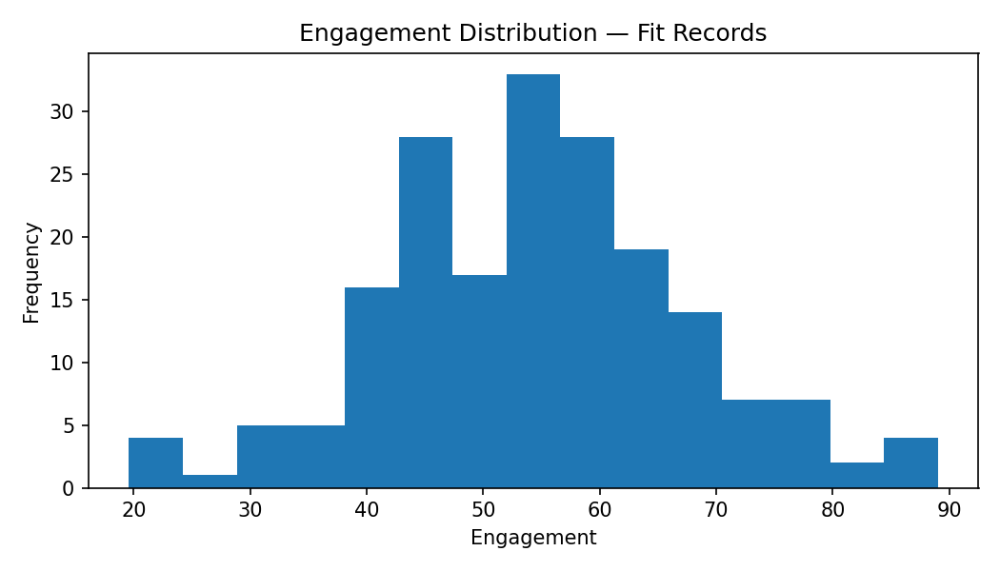
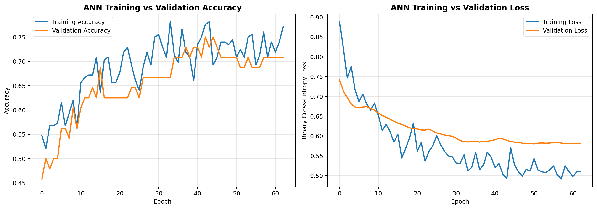
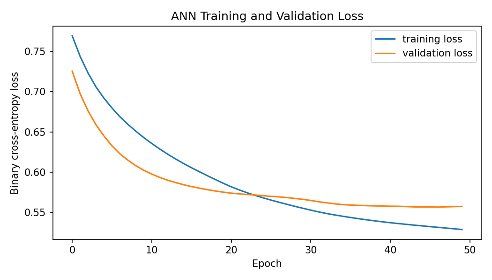
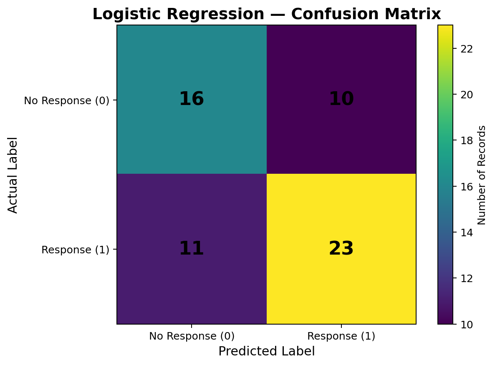

# Campaign Response Analysis

A Python and Jupyter Notebook project for exploring campaign engagement and response data using descriptive statistics, statistical inference, linear algebra, and machine-learning workflows.


🎥 Project Demo Video

Watch the complete Campaign Response Analysis project demonstration:

[▶️ Click here to watch the project demo video](https://drive.google.com/file/d/1bVTaucbqc8KWKPLoVHGOJVR2GRGMICw-/view?usp=sharing)


## Project Preview

### 1. Engagement Distribution


### 2. ANN Training Performance


### 3. ANN Loss Curve


### 4. Logistic Regression Confusion Matrix



## Project Objectives

- Load and inspect campaign response data.
- Check data types, missing values, and duplicate records.
- Calculate engagement statistics such as count, mean, median, and sample standard deviation.
- Visualize engagement distributions.
- Compare groups using Welch's independent-samples t-test.
- Calculate a confidence interval for the mean.
- Explore covariance, eigenvalues, and eigenvectors.
- Prepare data for supervised and unsupervised learning tasks in the notebook.

## Dataset

The sample dataset is located at:

```text
data/raw/set_d.csv
```

Expected columns include:

| Column | Description |
|---|---|
| `record_id` | Record identifier |
| `visits` | Number of visits |
| `recency` | Recency value |
| `engagement` | Engagement score |
| `spend` | Spending value |
| `group` | Campaign group (for example, G1 or G2) |
| `response` | Response target |

The included CSV is **synthetic practice data**, not a verified official exam dataset. If your instructor supplied a dataset, replace `data/raw/set_d.csv` with that file before running the notebook. The values in the charts and analysis depend on the dataset.

## Requirements

- Python
- Jupyter Notebook
- pandas
- NumPy
- Matplotlib
- SciPy
- scikit-learn
- Other packages listed in `requirements.txt`

Install the requirements from the project directory:

```bash
python -m pip install -r requirements.txt
```

Then launch Jupyter:

```bash
jupyter notebook
```

Open `campaign_response.ipynb` and run the cells from top to bottom.

## Run on Windows

In PowerShell, from the extracted project directory:

```powershell
python -m venv .venv
.\.venv\Scripts\Activate.ps1
python -m pip install --upgrade pip
pip install -r requirements.txt
jupyter notebook
```

If package installation fails, check the Python-version compatibility of the package named in the error. TensorFlow in particular may not support every Python version or Windows setup.

## Output Files

When the notebook runs, it may create or save outputs such as:

- Statistical summary tables
- Welch's t-test and confidence interval results
- Covariance matrix and eigen decomposition tables
- Engagement and other analysis plots
- Model evaluation results and related artifacts

The exact output paths depend on the folder paths configured in the notebook.

## Important Note About Missing Values

The number of fit records can differ from the number of observed engagement values. For example, 192 fit records with 2 missing engagement values produce `observed_n = 190`. The notebook should report the real count and calculate statistics from non-missing observations; do not hard-code a desired mean or replace missing values merely to force a target output.

## Repository Structure

```text
Campaign_Response_Updated_Project/
├── campaign_response.ipynb
├── requirements.txt
├── README.md
├── data/
│   └── raw/
│       └── set_d.csv
└── assets/
    ├── engagement_distribution.png
    ├── response_distribution.png
    ├── engagement_by_group.png
    └── correlation_matrix.png
```

## Author

Student project — Campaign Response Analysis
